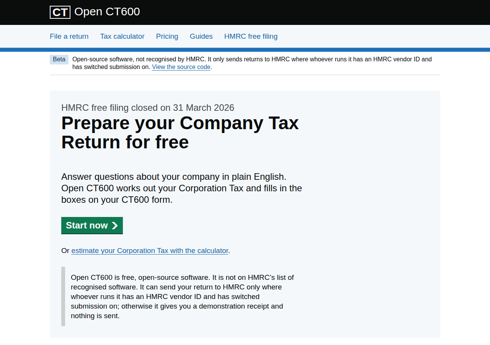
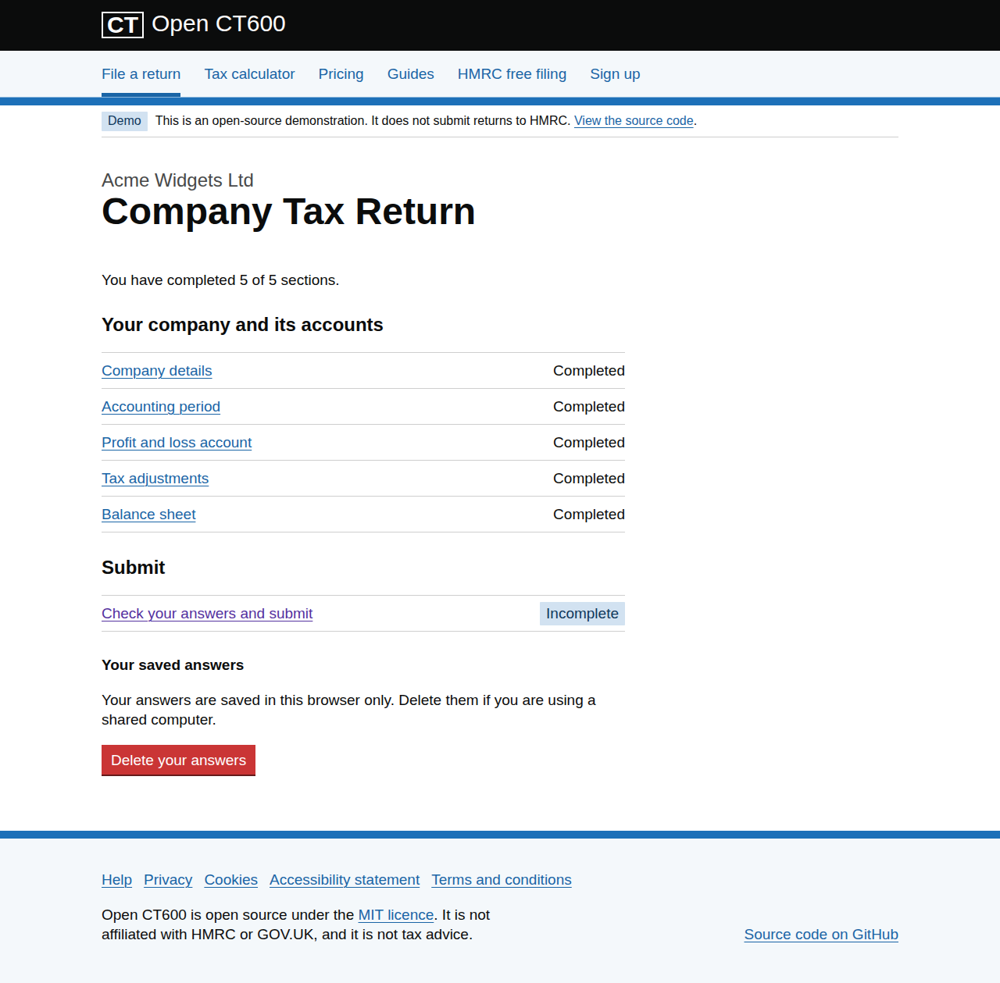
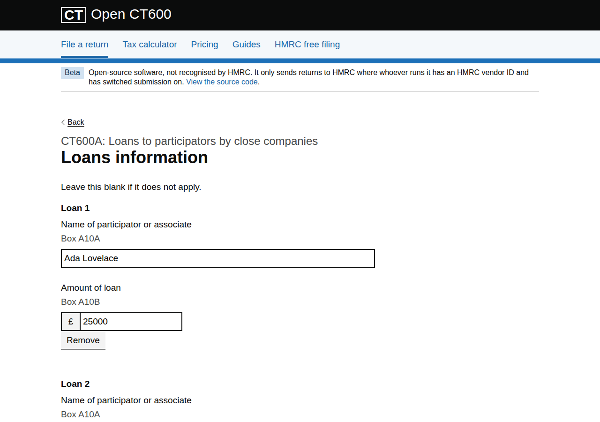
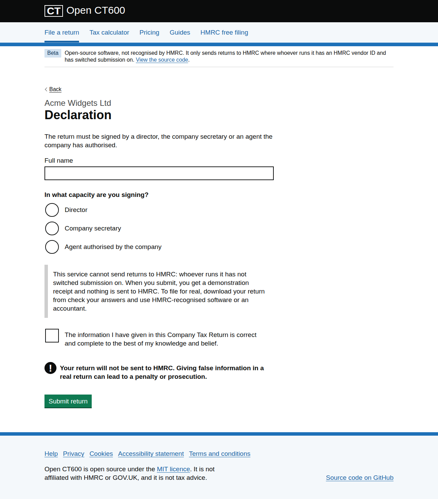

# Open CT600

A free, open-source website for preparing and filing a UK Company Tax Return (CT600). It takes the place
of HMRC's old online filing service for small companies, which closed on 31 March 2026, and replicates
[taxpipe.co.uk](https://taxpipe.co.uk/) as open source. Try it at
[open-ct600.hails.info](https://open-ct600.hails.info).

**Status:** active and early (version 0.1.0). It was built between 28 September and 7 October 2026
in 33 pull requests. The public site prepares and checks returns but **does not file them with
HMRC**: submission is switched off there, and the project has not been through HMRC's software
recognition process.

> **Open CT600 is not HMRC-recognised software, and it is not tax advice.** It is not a substitute
> for an accountant or tax adviser, and nobody with a professional tax qualification has reviewed
> its calculations. You are responsible for the return your company files: check every figure, and
> get professional advice if your company's affairs are anything other than simple. HMRC's checks
> (below) confirm that a return is well formed and internally consistent. They do not confirm that
> the figures are right for your company. A deployment submits returns to HMRC only when its
> operator holds an HMRC vendor ID and switches submission on (see
> [Submitting to HMRC](#submitting-to-hmrc)). Otherwise it prepares and checks your return, gives you
> the files, and issues a demonstration receipt.

## Key takeaways

- **It prepares a complete CT600 for a small UK company**, covering the main return, supplementary
  pages A–P, iXBRL accounts and computations, and the CT600 XML. See
  [What it does](#what-it-does).
- **The files it produces pass HMRC's own checks for every return shape that is tested**
  [confidence: ~90%]. The tests run HMRC's XSD and 1,072 business rules offline, and Arelle validates
  the iXBRL. 906 backend and 683 frontend tests passed on a fresh clone during this audit. See
  [How it is verified](#how-it-is-verified).
- **HMRC's validation service has accepted generated returns** [confidence: ~85%]. The evidence is
  commit messages, not a stored run log: commit `1610511` records all 18 TPVS cases then in the
  suite as accepted on 2026-09-29, and later commits record TPVS accepting the cases they added. This
  audit did not re-run them, because they call HMRC's network service. See
  [How it is verified](#how-it-is-verified).
- **The tax figures are probably right for straightforward small-company cases, but nobody has
  independently checked them** [confidence: ~75% for a simple trading company; lower for reliefs
  and unusual cases]. They rest on worked examples from HMRC guidance, encoded as unit tests by the
  same author who wrote the code. See [What the project's value rests on](#what-the-projects-value-rests-on).
- **Live filing with HMRC has never been exercised.** The submit, poll and delete flow is tested
  only against a stub Transaction Engine [confidence that it works first time against HMRC: ~60%].
  See [Submitting to HMRC](#submitting-to-hmrc).
- **Some cases are refused or not calculated**, including insurance companies, periods longer than
  12 months and the £5 million losses restriction. See [Known limitations](#known-limitations).

Confidence tags are an assessment of the evidence in this repo (sample sizes, seeds, intervals),
added in a 2026-10 README audit; they are not new measurements. For a tool like this they mean "how
likely the claim holds for a typical user's return", judged from the test suite, the commit history
and the design docs.

## Contents

- [Stack](#stack)
- [What it does](#what-it-does)
- [What the project's value rests on](#what-the-projects-value-rests-on)
- [How it is verified](#how-it-is-verified)
- [Submitting to HMRC](#submitting-to-hmrc)
- [Looking companies up at Companies House](#looking-companies-up-at-companies-house)
- [Known limitations](#known-limitations)
- [How it was built](#how-it-was-built)
- [Running it](#running-it)
- [API](#api)
- [Development](#development)
- [Licence](#licence)

## Stack

- **Frontend:** React 19 + TypeScript (Vite), built on the [GOV.UK Design System](https://design-system.service.gov.uk/)
  (`govuk-frontend` 6).
- **Backend:** Python 3.13 + FastAPI. It computes Corporation Tax, reliefs and every CT600 box. It also
  produces the iXBRL accounts and computations and the CT600 XML, validates them against HMRC's own
  rules, and can submit them to HMRC.



## What it does

| Area | What you get |
| --- | --- |
| Filing service (`/file`) | GOV.UK start page, task list and question pages: company details, accounting period, profit and loss, tax adjustments, balance sheet, accounts details (standard, directors, approval, dormancy), reliefs, and supplementary pages. |
| Supplementary pages | CT600A–CT600P (CT600G is dormant). The user picks the pages that apply. Each page is a form generated from HMRC's schema, with box numbers as hints and add-another lists; the service works out the calculated boxes. |
| Reliefs | Group relief (CT600C). R&D: SME and large-company RDEC before 1 April 2024; merged RDEC or ERIS after. Loans to participators (s455, CT600A). The calculations for each page and how they feed the main return. |
| Check your answers | Every CT600 box, the tax computation, the reliefs and the accounts. HMRC's offline validation is shown too: its XSD and all 1,072 business rules, with HMRC's error codes, linked to the question to fix. |
| Files | iXBRL statutory accounts (micro-entity FRS 105 or small FRS 102 1A, FRC 2026 taxonomy); iXBRL Corporation Tax computations (HMRC ct-comp 2024); CT600 XML (schema v1.994) with both attached. |
| Submission | Test in Live or live submission through HMRC's Transaction Engine, using the company's Government Gateway user ID and password. The password is passed straight to HMRC and never stored or logged. The confirmation shows HMRC's receipt: IRmark, correlation ID and accepted time. |
| Tax calculator (`/calculator`) | Corporation Tax for any period from 1 April 2017 to 31 March 2027, with marginal relief, associated companies, short periods and periods that span 1 April. |
| Content | Home, pricing (free), HMRC free-filing closure explainer, guides, help/FAQ, privacy, cookies (none are used), accessibility statement and terms. |

Drafts are kept only in the user's browser (`localStorage`). The API stores nothing.

| Task list | Supplementary page (CT600A) | Check your answers | Declaration |
| --- | --- | --- | --- |
|  |  |  |  |

## What the project's value rests on

Two things carry almost all the weight. Read the rest of this README with them in mind.

1. **The tax computation must match HMRC's rules.** Nothing downstream can catch a wrong figure
   that is internally consistent. HMRC's XSD, business rules and TPVS check a return's form and
   arithmetic, not whether the profit, reliefs or rates are right for the company. The only
   evidence for the figures is the unit tests built from HMRC's worked examples
   ([How it is verified](#how-it-is-verified)). Their author also wrote the code, and no tax
   professional has reviewed either. This is the most important missing piece.
2. **HMRC's own validators are the acceptance test for the files.** The project runs HMRC's
   published schema and schematron offline and sends test returns to TPVS rather than writing its own
   checks. So a pass means what HMRC's checks mean, no more. Those checks cover only the return
   shapes in the test suite.

## How it is verified

| What | How |
| --- | --- |
| Tax, reliefs and pages | Unit tests using worked examples from HMRC guidance and manuals for each relief and page, checked by hand. Mutation checks on the core formulas (no mutation-testing tool or record of these runs is in the repo; the in-repo mutation tests break iXBRL documents to prove the Arelle validator rejects them). |
| CT600 XML | Every return shape in the tests passes HMRC's v1.994 XSD and HMRC's schematron offline with zero problems. |
| IRmark | Reproduces HMRC's published worked example byte for byte. |
| iXBRL | Every generated document passes [Arelle](https://arelle.org/) offline, with the UK plugin and the HMRC disclosure system, against the FRC and HMRC taxonomy packages pinned by SHA-256 in `specs/ixbrl/taxonomies.tsv`. Any warning fails the test. |
| End to end with HMRC | `pytest -m hmrc_tpvs` sends synthetic returns with real iXBRL to HMRC's third-party validation service (TPVS) and expects a signed receipt whose digest equals our IRmark. The returns are micro-entity, small company, net liabilities, group relief, s455 loans, SME R&D, merged RDEC, ERIS and a tax avoidance scheme disclosure. All pass. |
| Transaction Engine | Submit → poll → delete and every HMRC error class are tested against a stub Transaction Engine that replays HMRC's messages. |

How much each row supports:

- **Offline checks (XSD, schematron, IRmark, Arelle):** strong evidence that the files are well
  formed for the tested shapes [confidence: ~90%]. These run in CI on every push and pull request
  (`.github/workflows/ci.yml`). On 2026-10-17 a fresh clone passed 906 backend tests (`uv run pytest`,
  with 23 network tests deselected by default) and 683 frontend tests (`pnpm test`). Return shapes
  that no test covers are not covered by this evidence.
- **TPVS:** the strongest outside evidence that HMRC accepts the message [confidence: ~85%]. It is
  opt-in and needs the network, so CI does not run it. Acceptance is recorded only in commit
  messages (for example `1610511`: "all 18 TPVS cases were accepted on 2026-09-29").
- **Tax and relief figures:** moderate evidence [confidence: ~75% for a simple trading company;
  lower for reliefs, group relief and ring fence trades]. The tests check the code against HMRC's
  worked examples, which cover the common paths. They cannot show that every combination of
  reliefs and periods is handled correctly.

## Submitting to HMRC

HMRC accepts CT600 returns only from software that sends its vendor ID. HMRC's Software Developers
Support Team (SDSTeam@hmrc.gov.uk) issues the ID and runs the recognition process. To enable
submission on your deployment:

```sh
HMRC_VENDOR_ID=1234            # your 4-digit HMRC vendor ID
HMRC_SUBMISSION_ENABLED=true   # off by default, so a public demo never handles Gateway passwords
```

- **Test in Live** (class `HMRC-CT-CT600-TIL`) has HMRC check the whole return with real credentials,
  without filing it.
- **Protect a submitting deployment.** With submission on, the service passes whatever Government
  Gateway credentials it receives to HMRC under your vendor ID. Put it behind your own authentication
  and rate limiting, so it can't be used to test credentials against HMRC. With submission off, the
  page never asks for credentials.
- **Not yet exercised against HMRC:** live and Test in Live submission need a vendor ID and real
  credentials, so the submit → poll → delete flow is tested only against the stub Transaction Engine.
  The message itself (schema, business rules, IRmark and iXBRL) is proven on TPVS.

## Looking companies up at Companies House

Set `COMPANIES_HOUSE_API_KEY` to a Companies House public data API key to let users fill in the
company's details, directors and last year's figures from its public record. The service keeps
under the key's limit of 600 requests per 5 minutes and gives each client address its own small
share. Behind a reverse proxy, set `TRUSTED_PROXIES` to the number of proxies that append to
`X-Forwarded-For`, or every user shares the proxy's share. On a public deployment, put lookups
behind your own rate limiting too.

## Known limitations

- **Not professional advice, and not reviewed by a professional.** See the warning at the top. The
  service asks questions in plain English and computes the boxes. It does not judge whether your
  answers are right, for example whether an expense is allowable or a relief applies.
- **Financial years 2017 to 2026 only.** Corporation Tax rates are modelled for periods from
  1 April 2017 to 31 March 2027 (`RATES` in `backend/src/open_ct600/tax.py`).
- **Computations for periods ending after 31 March 2026.** HMRC accepts its 2024 computations
  taxonomy only for these earlier periods, and has not yet published the 2025 one. For later periods the
  service explains this and does not submit; the accounts and CT600 XML are still produced.
- **s455 at 35.75%.** Loans made from 6 April 2026 are filed at 33.75%, because HMRC's online service
  accepts the new rate only from April 2027. The difference is shown as tax due on amendment.
- **Not calculated:**
  - The restriction on using carried-forward losses above the £5 million deductions allowance.
  - Income tax deducted from income (box 515).
- **Refused, with a clear message rather than a wrong return:**
  - Insurance companies (company type 5) and REIT tax-exempt businesses (type 10).
  - Periods of account longer than 12 months.
  - Ring fence trades in periods starting before 1 April 2023, because the older ring fence limits aren't modelled.
- **CT600A later-repayment relief** assumes the company's later accounting periods are 12 months long,
  because the page has no field for them.
- **No PDF attachments.** Answers that HMRC requires a PDF for are rejected, for example CT600C
  "notices of consent attached" (HMRC rule 9552). Use the simplified arrangements authorisation
  instead.
- **Some computation steps are untagged.** HMRC's ct-comp 2024 taxonomy has no elements for
  marginal relief or the merged RDEC and ERIS steps, so those appear in the computation text
  untagged. (Earlier versions of this README also said the accounts had no prior-year comparatives
  and always used private limited company as the legal form. Both have been supported since
  [#19](https://github.com/DJRHails/open-ct600/pull/19).)

## How it was built

One author built the project in 33 pull requests between 28 September and 7 October 2026. The design
is in [`docs/design/`](docs/design/), and the official material it was built against is in
[`specs/`](specs/README.md): HMRC's schemas and business rules, the box map, samples, taxonomy pins
and research notes on submission, iXBRL and the supplementary pages. Rules came from HMRC's
published guidance, manuals and worked examples. Correctness was checked by HMRC's own validators
and TPVS, not by an accountant. Several later PRs fixed tax rules found wrong on review, for example
company types, group relief limits, ERIS, loss boxes and s458 timing
([#15](https://github.com/DJRHails/open-ct600/pull/15)), and post-2017 losses in box 285
([#27](https://github.com/DJRHails/open-ct600/pull/27)). Expect more errors of this kind in paths
that the tests do not reach.

## Running it

You need Python 3.13 with [uv](https://docs.astral.sh/uv/), Node 22 and pnpm 12.

```sh
# API on :8000
cd backend && uv sync && uv run uvicorn --factory open_ct600.main:create_app --reload

# Frontend on :5173, which proxies /api to :8000
cd frontend && pnpm install && pnpm dev
```

### Docker

One image serves both the API and the built frontend:

```sh
docker build -t open-ct600 .
docker run --rm -p 8000:8000 open-ct600
```

### The public site

[open-ct600.hails.info](https://open-ct600.hails.info) runs this image with Companies House lookup on
and HMRC submission off. Each push to `main` that changes the app deploys it
(`.github/workflows/deploy.yml`): CI builds and pushes the image to GHCR, then a deploy runner on the
host runs [`deploy/deploy.sh`](deploy/deploy.sh). That script starts the container, waits for its
health check, and installs the Caddy site in [`deploy/`](deploy/). The key comes from the repository's
`COMPANIES_HOUSE_API_KEY` Actions secret.

## API

| Method | Path | Purpose |
| --- | --- | --- |
| `GET` | `/api/health` | Liveness |
| `GET` | `/api/schema/pages` | Supplementary pages A–P: their schema trees and the boxes the service calculates |
| `POST` | `/api/calculator` | Corporation Tax for a period and taxable profits |
| `POST` | `/api/returns/compute` | CT600 boxes, tax computation, reliefs, completed pages and accounts |
| `POST` | `/api/returns/validate` | HMRC's XSD and business rules run offline, with problems mapped to boxes and questions |
| `POST` | `/api/returns/accounts.xhtml` | iXBRL statutory accounts |
| `POST` | `/api/returns/computations.xhtml` | iXBRL Corporation Tax computations |
| `POST` | `/api/returns/ct600.xml` | CT600 XML with the iXBRL attached |
| `POST` | `/api/returns/submit-to-hmrc` | Test in Live or live submission; needs `HMRC_SUBMISSION_ENABLED` and `HMRC_VENDOR_ID` |
| `POST` | `/api/returns/submit` | Demonstration receipt. Nothing is sent to HMRC. |

The return endpoints take `{"ct600": …, "declaration": …}`. Interactive docs are at `/docs`.

## Development

```sh
# backend (add -m hmrc_tpvs to run the opt-in TPVS tests; synthetic data only)
cd backend && uv run ruff format --check . && uv run ruff check . && uv run ty check && uv run pytest

# frontend
cd frontend && pnpm lint && pnpm format:check && pnpm test && pnpm build
```

The same checks run in CI (`.github/workflows/ci.yml`) and as [prek](https://github.com/j178/prek)
hooks (`prek install`). The design is in [`docs/design/filing-with-hmrc.md`](docs/design/filing-with-hmrc.md).
The official material it is built against is in [`specs/`](specs/README.md): HMRC schemas and
business rules, the box map, samples, taxonomy pins and research notes.

The maintainers' development secrets (the Companies House API key) are in `.env.shared`,
encrypted with [glassine](https://github.com/DJRHails/glassine); its recipients are listed in
`.sops.yaml`. A recipient runs `glassine init` once in a clone, then loads the file to run the
live Companies House tests or look companies up locally:

```sh
set -a; . ./.env.shared; set +a
cd backend && uv run pytest -m companies_house_live
```

### Design system notes

The site uses `govuk-frontend` components and patterns. It is not a GOV.UK service, so it follows the
Design System's rules for services outside GOV.UK:

- It uses the Arial font stack, not GDS Transport.
- It has no crown or crest: the image URL function resolves the crest to `none`.
- It uses the Generic header component rather than the GOV.UK header.

## Licence

[MIT](LICENSE). HMRC schemas and documents in `specs/` are Crown copyright under the Open Government
Licence v3.0.
